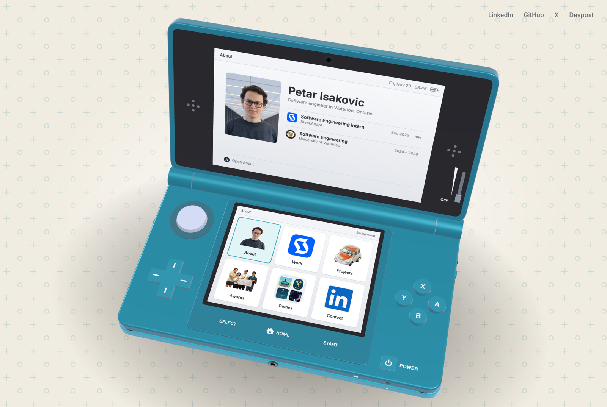

# My 3DS Website

Hi, I'm Petar. I study Software Engineering at the University of Waterloo.

This is my personal website. I didn't want a normal portfolio, so I built a 3DS you can actually play with. It's all made in code with three.js.

## Things to try

- Scroll down to open the lid
- Drag to spin it around
- Use the arrow keys and Enter to look through the menu
- Plug in the headphones to play music
- Slide the 3D slider up
- Pull out the SD card and the game card
- Take out the four screws on the back
- Play the games

There are a few more secrets. Go find them.

## Run it yourself

You don't need to install anything.

```
git clone https://github.com/PetarIsakovic/nintendo-3ds-website.git
cd nintendo-3ds-website
python3 -m http.server 8000
```

Then open localhost on port 8000 in your browser.

## Make it your own

Feel free to use this as a starting point for your own site. Most of the text lives near the top of `main.js`. Please swap in your own photos and logos.

Not affiliated with Nintendo. I just really like the 3DS.
